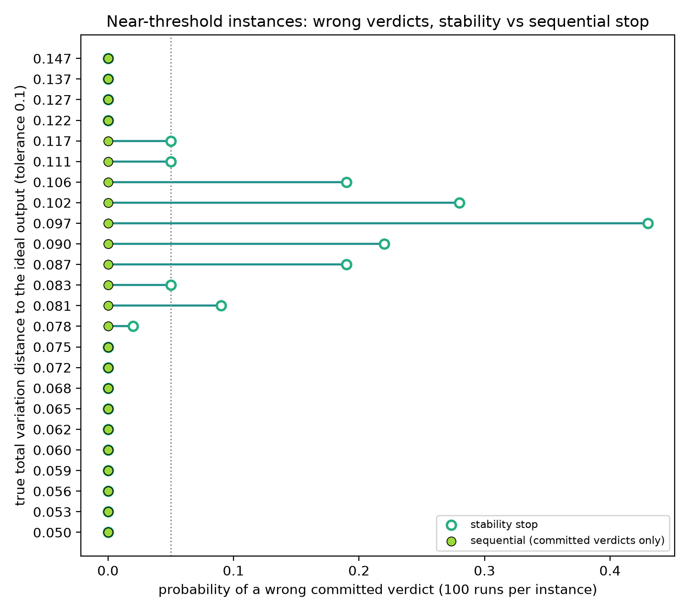
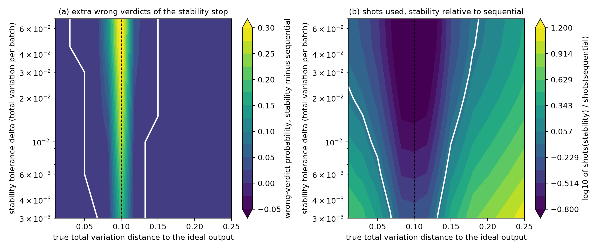
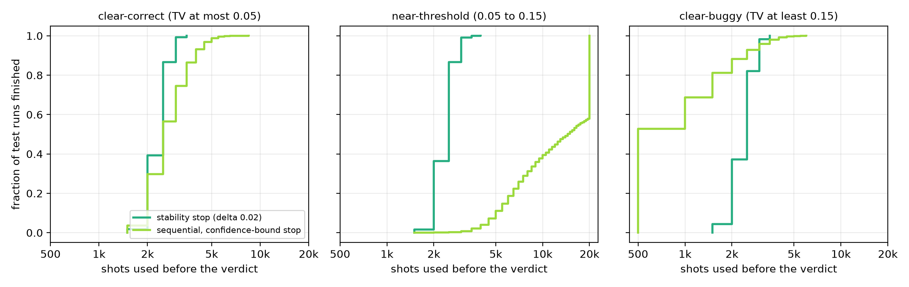
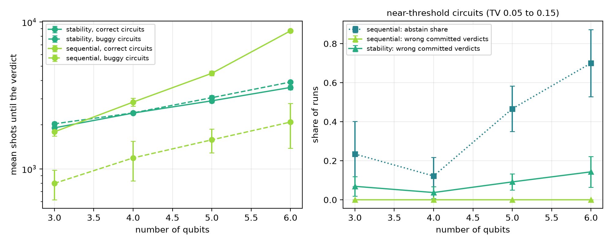
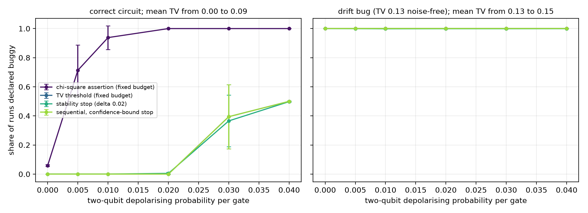
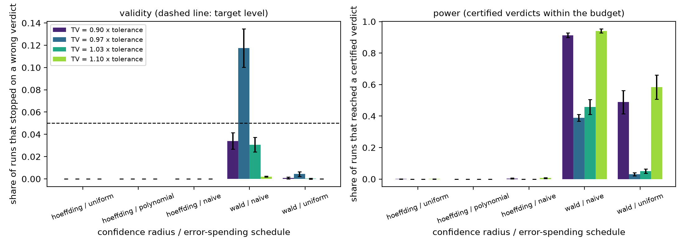

# When may a shot-based quantum circuit test stop? An anytime-valid stopping rule against exact noisy outputs





**Abstract.** Quantum software tests are random experiments: a circuit is run for many shots and its output distribution is
compared with the ideal one, and the only published early-stopping rule (stop when the distribution stops moving) comes with
no error guarantee. This project builds a sequential test that stops when a Hoeffding confidence interval for the total
variation (TV) distance to the ideal output clears a tolerance, and compares it with a stability stop, a fixed-budget TV
threshold and a chi-square assertion on 900 simulated three-family, four-qubit test cases with exact noisy distributions.
In simulation, the stability stop commits a wrong verdict on 0.136 +- 0.044 of runs near the tolerance while the sequential
test commits none, at the price of abstaining on 0.815 +- 0.053 of those runs; the guarantee also costs more shots on correct
circuits as qubits grow.

## Motivation

Quantum software engineering (QSE) needs test oracles that survive noise and cheap shots. Kim et al. (2027) found that quantum
test flakiness is rare but hard to detect, with failure probabilities down to about 1e-3 that need thousands of reruns;
Ishikawa and Saito (2027) price shots across services; and Bocci et al. (2027) formalise stopping once extra shots no longer
change the output, while stating that finite-time certification would need confidence-sequence machinery. On noisy
intermediate-scale quantum (NISQ) devices every shot costs money and queue time, so "how many shots is enough for a verdict
I can trust?" is an engineering question with a statistical answer.

## Research gap

The literature (full table in [`docs/RESEARCH_GAP.md`](docs/RESEARCH_GAP.md)) treats shots as a cost (Ishikawa and Saito, 2027,
digital object identifier (DOI) 10.1016/j.infsof.2026.108361), measures flakiness at scale (Kim et al., 2027, DOI
10.1016/j.jss.2026.113106), and offers a stability-based stopping semantics (Bocci et al., 2027, DOI 10.1016/j.jlamp.2026.101174)
whose verdict error is not bounded. Surveys list statistical assertions on repeated measurements as a core technique
(García de la Barrera et al., 2023, DOI 10.1002/smr.2419; Andrews et al., 2026, DOI 10.1109/MDAT.2026.3698368), and the
landmark NISQ papers stress noise and readout (Leymann and Barzen, 2020, DOI 10.1088/2058-9565/abae7d; Corcoles et al., 2020,
DOI 10.1109/JPROC.2019.2954005). Missing: a stopping rule with a finite-sample error bound, and a measurement of where the
stability rule fails, against circuits whose noisy output is known exactly.

## What is new here

- The stability stop of incremental execution is compared, for the first time in this setting, with a sequential test that has
  a finite-sample bound on the probability of a wrong stopped verdict.
- Truth is exact: every instance's TV distance to the ideal output comes from density-matrix simulation, so wrong verdicts
  are counted, not estimated.
- Results separate "wrong committed verdict" from "abstain", and report the shot price of the guarantee against qubit count.
- An ablation shows which part of the confidence rule buys validity: radius type versus error-spending schedule.

## Method

A circuit is correct if TV(true noisy output, ideal output) is at most the tolerance tau = 0.10, and buggy otherwise. Shots
arrive in batches of 500 with a 20,000-shot budget. Details: [`docs/METHOD.md`](docs/METHOD.md).

```mermaid
%%{init: {'theme': 'base', 'themeVariables': {'primaryColor': '#ffffff', 'primaryTextColor': '#000000', 'primaryBorderColor': '#000000', 'lineColor': '#000000', 'secondaryColor': '#ffffff', 'tertiaryColor': '#ffffff', 'background': '#ffffff', 'noteBkgColor': '#ffffff', 'noteTextColor': '#000000', 'actorBkg': '#ffffff', 'actorBorder': '#000000', 'actorTextColor': '#000000', 'signalColor': '#000000', 'signalTextColor': '#000000', 'labelBoxBkgColor': '#ffffff', 'labelTextColor': '#000000', 'clusterBkg': '#ffffff', 'clusterBorder': '#000000'}}}%%
stateDiagram-v2
    state "Draw the next batch of 500 shots<br/>from the circuit under test" as Draw
    state "Update the empirical distribution<br/>and the estimate TV_hat of the<br/>total variation distance" as Update
    state "Build the interval TV_hat plus or<br/>minus r_t with the Hoeffding radius<br/>and error level alpha over T looks" as Interval
    state "Interval lies above tolerance tau:<br/>stop with verdict buggy" as Buggy
    state "Interval lies below tolerance tau:<br/>stop with verdict correct" as Correct
    state "Interval straddles tau and<br/>batches remain: continue" as Continue
    state "Budget of 40 batches is spent:<br/>abstain, report inconclusive" as Abstain
    [*] --> Draw
    Draw --> Update
    Update --> Interval
    Interval --> Buggy
    Interval --> Correct
    Interval --> Continue
    Interval --> Abstain
    Continue --> Draw
    Buggy --> [*]
    Correct --> [*]
    Abstain --> [*]
```

Legend: TV = total variation distance; TV_hat = its estimate from shots; r_t = confidence radius after t batches.

Baselines, all on the same simulated shot streams:

- **Chi-square assertion (fixed budget):** the standard statistical oracle, rejects exact equality with the ideal distribution.
- **TV threshold (fixed budget):** the classical baseline, declares buggy if the estimated TV exceeds tau after the full budget.
- **Stability stop:** an IncrementalExecution-style rule, stops when the last two batch-to-batch TV changes are below 0.02.
- **Sequential (proposed):** the state machine above. The radius is sqrt((K ln 2 + ln(2 / delta_t)) / (2 m_t)) for K = 2^n
  outcomes and m_t shots, with delta_t = alpha / T, alpha = 0.05 and T = 40.

Circuits: `layered`, `ghz` (Greenberger-Horne-Zeilinger preparation plus single-qubit Y-rotations) and `qft` (quantum Fourier
transform of a product state); bug = angle drift of 0 to 1.2 rad on one rotation; depolarising noise on every gate.

## Results

All numbers below come from `results/` (mean +- standard deviation over five circuit seeds; 900 test cases at four qubits,
100 runs each; `results/run_meta.json`). Clear-correct means TV <= 0.05, clear-buggy TV >= 0.15, near-threshold in between.

| Procedure | False-fail on clear-correct | Missed bug on clear-buggy | Shots, clear cases | Wrong committed verdict, near-threshold | Abstain, near-threshold | Shots, near-threshold |
|---|---|---|---|---|---|---|
| Chi-square assertion | 0.916 +- 0.013 | 0.000 +- 0.000 | 20000 | 0.671 +- 0.070 | 0 | 20000 |
| TV threshold, fixed budget | 0.000 +- 0.000 | 0.000 +- 0.000 | 20000 | 0.022 +- 0.013 | 0 | 20000 |
| Stability stop | 0.000 +- 0.000 | 0.000 +- 0.000 | 2376 +- 26 | 0.066 +- 0.019 | 0 | 2395 +- 47 |
| Sequential (proposed) | 0.000 +- 0.000 | 0.000 +- 0.000 | 2060 +- 159 | 0.000 +- 0.000 | 0.414 +- 0.081 | 13617 +- 1213 |

Source: `results/main_table.csv`. For the sequential test, a run that abstains also yields a forced point-estimate verdict at the
end of the budget; its wrong rate on near-threshold cases is 0.022 +- 0.013, identical to the fixed-budget TV threshold.

### Claim 1. The stability stop commits wrong verdicts near the tolerance; the sequential test does not, but it abstains

Within 25% of tau (TV from 0.075 to 0.125, 173 instances; `results/band_table.csv`) the stability stop is wrong on
0.136 +- 0.044 of runs, the fixed-budget TV threshold on 0.045 +- 0.021, and the sequential test commits 0.000 +- 0.000 wrong
verdicts while abstaining on 0.815 +- 0.053.



*Fig. 1. Per-instance wrong-verdict probability near the tolerance: the stability stop (open) peaks at 0.43 among the 24 plotted
instances (largest in all of `results/instance_level.csv`: 0.76), the sequential test (filled) stays at 0.*



*Fig. 2. Left: extra wrong verdicts of the stability stop in a narrow band around tau, for every stability tolerance tried
(`results/stability_sweep.csv`). Right: where the stability stop is cheaper (green) or dearer (dark) than the sequential test.*

Caveat: the stability tolerance matters (at 0.003 the band 0.09 to 0.11 still has 0.191 wrong verdicts, at 0.07 it has 0.347),
but no value removes the failure. The sequential test buys its zero by not answering: its forced end-of-budget verdict is no
better than the fixed-budget threshold.

### Claim 2. The sequential test is cheaper on clear bugs, dearer on clear-correct circuits, and the gap grows with qubits

Mean shots to a verdict (`results/shots_by_class.csv`): clear-buggy 1101 +- 262 (sequential) versus 2391 +- 79 (stability);
clear-correct 2809 +- 101 versus 2377 +- 39. Across 3 to 6 qubits (`results/scaling_summary.csv`, budget 40,000 shots) the
sequential cost on correct circuits rises from 1789 +- 115 to 8719 +- 186 shots, against 1904 +- 83 to 3588 +- 117 for the
stability stop; on bugs it rises from 798 +- 181 to 2085 +- 705.



*Fig. 3. Empirical CDFs of shots to verdict: the sequential test is fastest for bugs, spread out for correct circuits, and
sits at the budget for near-threshold cases.*



*Fig. 5. Left: shots to a verdict versus qubits. Right: on near-threshold circuits the sequential abstain share rises to
0.700 +- 0.172 at six qubits while the stability stop's wrong committed verdicts rise to 0.143 +- 0.079.*

Caveat: the exponential dependence comes from the union bound over 2^K outcome subsets in the radius, not from the circuits.
The 3 to 6 qubit range is too short to claim a scaling law.

### Claim 3. Exact-equality assertions are not usable on noisy hardware, and tolerance-based rules are insensitive to noise until TV crosses tau

The chi-square assertion declares correct circuits buggy on 0.916 +- 0.013 of clear-correct cases, and for a correct circuit
with two-qubit depolarising probability 0.005 (true TV 0.012) it does so on 0.714 +- 0.173 of runs, rising to 1.000 at 0.02
(`results/noise_summary.csv`). The three tolerance-based rules declare it buggy on 0.000 up to 0.01. A bug with TV 0.13 noise-free is
caught by every procedure at every noise level (at least 0.998).



*Fig. 4. Share of runs declared buggy versus noise: chi-square rejects almost at once, the others only when the true TV
approaches tau.*

Caveat: at noise 0.03 and above some correct circuits (the `layered` family) truly exceed tau, so the 0.394 +- 0.221 and
0.500 +- 0.000 rates of the tolerance-based rules there are partly correct verdicts, not errors.

### Ablation: what buys validity

On 14 boundary instances per margin (TV = 0.90, 0.97, 1.03, 1.10 times tau; `results/ablation_summary.csv`):



*Fig. 6. Left: runs that stopped on a wrong verdict, per radius and spending schedule (dashed line: 0.05). Right: runs that
reached a certified verdict.*

The asymptotic (Wald) radius with naive repeated peeking breaks the 0.05 level at TV = 0.97 tau (0.118 +- 0.017); with
uniform spending it returns to 0.004 +- 0.002. All three Hoeffding variants stop on a wrong verdict in 0.000 of runs, naive peeking included, but
certify almost nothing within the 20,000-shot budget at the boundary (certified share 0.000 at 0.97 and 1.03 tau, against 0.389 +- 0.021 and 0.457 +- 0.047 for Wald with
naive peeking). So the finite-sample radius is valid but conservative, and in this setting the spending schedule is not what
protects it; the guarantee costs power.

## Discussion

Hypotheses from `docs/RESEARCH_GAP.md`: H1 is supported (stability 0.136 +- 0.044 against a 0.05 threshold; sequential 0.000).
H2 is half rejected: the sequential test uses fewer shots for bugs but more for correct circuits. H3 is supported (0.714 +- 0.173
at noise 0.005).

Negative and unwelcome results: with a fixed 20,000-shot budget the plain TV threshold is as accurate as the sequential test
once abstentions are forced (0.022 +- 0.013 on near-threshold cases), and it is more accurate than the stability stop
(0.066 +- 0.019), so the case for the sequential test is the certificate and the early exit on clear cases, not accuracy per
shot at the boundary. Near the tolerance the sequential test almost always runs out of budget (abstain 0.414 +- 0.081 over the
whole near band). The stability stop stops after about 2400 shots whatever the margin (Fig. 3), which is exactly why it errs near tau.

## Limitations

- Simulation only: 3 to 6 qubits, exact density matrices, independent identically distributed multinomial shots. Real
  devices drift, and shots within a job can be correlated.
- The ideal distribution must be known; the union-bound radius grows as the square root of the number of outcomes.
- One bug type (angle drift), one noise family (depolarising), one tolerance (0.10) and one stability setting
  (patience 2) for the main table; no hardware, no compiler effects.
- Five circuit seeds; standard deviations are over seeds and some are large (for example 0.221 at noise 0.03).

## Future work

On a real QPU or a cloud queue the rule would run inside the job loop of a test runner, spending shots per test instead of
per suite. Next steps: tighter radii that exploit sparse outputs or Pauli-observable tests so the shot price does not grow
with 2^n; calibration of tau from device noise data; drift-aware sequences; and coupling to shot allocation across services
(Ishikawa and Saito, 2027) and to hybrid quantum-HPC (high-performance computing) schedulers (Cipollini et al., 2026,
DOI 10.1016/j.future.2026.108699), where a certified early exit frees scarce quantum processing unit (QPU) time.

## Related work by the author

- [`shot-fair-damped-qng-vqe-benchmark`](https://github.com/pradeepdegalaroyal/shot-fair-damped-qng-vqe-benchmark): charging every
  shot in a variational eigensolver benchmark.
- [`vqls-certificate-shot-cost-noise-floor`](https://github.com/pradeepdegalaroyal/vqls-certificate-shot-cost-noise-floor): shot
  cost of a precision certificate for a variational linear solver.

## Reproducibility

```bash
pip install -r requirements.txt
python experiments/run_all.py          # full study, about 155 s on a 16-thread central processing unit (CPU); no graphics processing unit (GPU) is used
python experiments/run_all.py --quick  # smoke run, about 25 s, writes results_quick/ and figures_quick/
python -m pytest -q                    # 6 tests, a few seconds
```

Hardware used: Windows 11 laptop, 16 CPU threads, Python 3.11.9, Qiskit 2.4.2, Qiskit Aer 0.17.2, NumPy 2.2.6, SciPy 1.17.1.
Every random stream is seeded; the full run rewrites `results/` (comma-separated values (CSV) files and `run_meta.json`) and `figures/`.

## Project structure

```
src/shotstop/circuits.py     circuits, drift bug, exact noisy distributions (Qiskit Aer)
src/shotstop/stats.py        total variation, Hoeffding and Wald radii, error-spending schedules
src/shotstop/verdicts.py     chi-square, fixed TV, stability and sequential procedures
src/shotstop/experiments.py  benchmark, ablation, noise sweep, scaling, summaries
src/shotstop/plots.py        the six figures
experiments/run_all.py       one-command reproduction (--quick for CI)
tests/                       fast pytest checks
docs/                        RESEARCH_GAP.md, METHOD.md
results/, figures/           raw and summary results, 200 dpi figures
```

## Citation

```bibtex
@software{degala_anytime_valid_shot_stopping_2026,
  author  = {Degala, Chenchupradeep},
  title   = {Anytime-valid shot stopping for pass/fail tests of noisy quantum circuits},
  year    = {2026},
  version = {0.1.0},
  url     = {https://github.com/pradeepdegalaroyal/anytime-valid-shot-stopping-quantum-circuit-tests},
  license = {MIT}
}
```

MIT license (`LICENSE`). See also `CITATION.cff`.
